  <h1>Hi there 👋🏼, I'm Josué</h1> 
  <h3>Passionate about autonomous learning, robotics and molecular computing</h3>

I am an intelligent systems developer with a passion for <b>reinforcement learning, robotics, and their applications to the biomedical field</b>. I am interested in the different facets of reinforcement learning and its use in training autonomous agents, as well as in exploring both <b>medical robotics and the field of molecular robotics</b>. In particular, I am interested in how reinforcement learning can advance robotic applications in medicine, from large-scale robotic systems to micro- and nanorobotics.

 

Most of my recent work revolves around designing custom reinforcement learning pipelines, investigating the theoretical properties of RL algorithms, studying autonomous agents' learning dynamics, working with vision-language-action models (VLAs), and exploring the possibility of encoding reinforcement learning in living matter.

 

My research interests include <i><b>sequential and long-horizon decision-making, deep reinforcement learning, goal-conditioned RL, inverse reinforcement learning (IRL), and algorithm optimization</b></i>. I am particularly interested in understanding how these approaches can improve the learning and decision-making capabilities of autonomous agents. From a more biologically oriented perspective, I’m also drawn to <i><b>DNA neural networks and chemical reaction networks</b></i>, particularly their potential as alternative computational paradigms.

 

 

🚀 I'm currently working on **autonomous control and navigation with goal-condition reinforcement learning** in my project [\[NanoGoal-RL\]](https://github.com/Josh012006/NanoGoal-RL). I've been **sharpening my skills in algorithm optimization** through [\[PPO-Leftovers\]](https://github.com/Josh012006/PPO-Leftovers). And in parallel, I'm exploring how I can recover some kind of reward [**Caenorhabditis elegans**](https://fr.wikipedia.org/wiki/Caenorhabditis_elegans) is optimizing in [\[Swim-IRL\]](https://github.com/Josh012006/Swim-IRL).

I have many more projects that I pinned just below. Check them out and let me know what you think. Also feel free to contribute or leave a star if you appreciate my work !

You can contact me via : 

- Email: **[josuesmjr.mongan@gmail.com](mailto:josuesmjr.mongan@gmail.com)**  

## 💪 Skills:
I have experience working with reinforcement learning frameworks like **Gymnasium** and **Stable-Baselines3**. I understand and I can write code in **Python** and **C/C++**. On the engineering side, I am well-versed in **Linux/Bash**. Most of my work is assisted by coding agents. So I also know how to use them efficiently and in a secure way to learn and to work.

Apart from that, I have 2+ years of experience in front end web development and a bit of experience when it comes to the back-end. So I can also design **React and Vue** web applications.

## 🌟 What I'm Looking For:
I'm up to work on exciting projects that align with my interests.

## 🎉 Fun Facts about me:
When I'm not coding, I like to play a bit of 🎹 **piano** (I'm not that good though 😅) or watching **japanese animation pieces (animes)** 🇯🇵 🈺. My favorite anime is called **Code Geass**, give it a try! Also I'm a **christian** always trying to bring **👑 Jesus's peace and love** everywhere I go. I'm particularly fond of **doing things in a simple way**. And lastly, I enjoy teaching and sharing my knowledge with others.

## My activity reports

  
  

 

  
  

